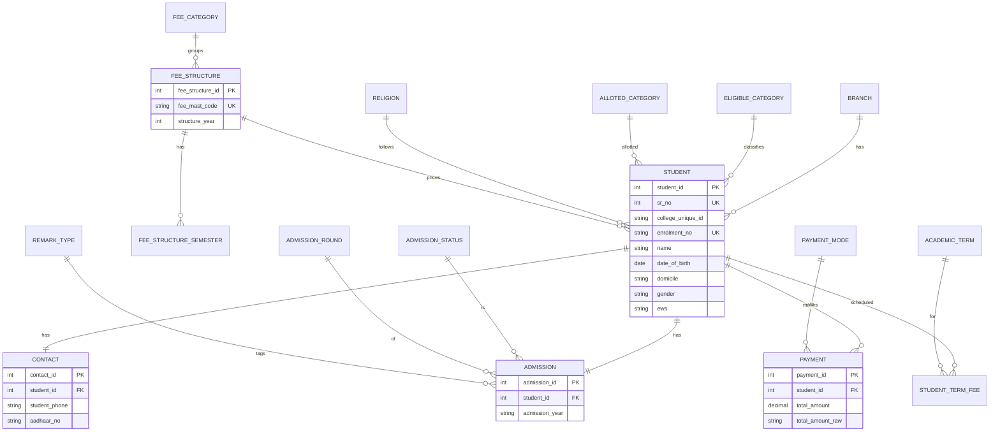

# ER Diagram (final for v1)

The attached “Excel to App — ER Diagram (Final)” is the right **entity list**. This version keeps those entities and fixes keys / 1NF issues found in the actual workbook.

## Entities

| Entity | Source | Notes |
|---|---|---|
| BRANCH | DATA.Branch | 22 codes including `_FW` and `-RR` |
| FEE_CATEGORY | FEE MAST.FEE CATEGORY | 8 codes |
| FEE_STRUCTURE | FEE MAST A–K | 72 plans; **not** Unique ID |
| FEE_STRUCTURE_SEMESTER | FEE MAST columns 1–8 | 1NF unpivot |
| FEE_YEAR_SEM_CODE | FEE MAST U–W | pivot helper |
| ELIGIBLE_CATEGORY / ALLOTED_CATEGORY | DATA | lookups |
| RELIGION, ADMISSION_STATUS, ADMISSION_ROUND, PAYMENT_MODE, REMARK_TYPE | DATA | slicer / dropdown dimensions |
| ACADEMIC_TERM | JUL-DEC20 … JAN-JUN29 | 18 terms |
| STUDENT | DATA identity + academics | surrogate `student_id` |
| CONTACT | DATA contact columns | 1:1 |
| ADMISSION | DATA admission columns | 1:1 |
| PAYMENT | DATA payment columns | 1:N allowed; Excel currently 1:1 |
| STUDENT_TERM_FEE | 18 fee columns | 1NF unpivot |
| SEARCH / REPORT | sheets | **views**, not tables |

## Keys

| Table | Primary key | Candidate / unique | Foreign keys |
|---|---|---|---|
| student | student_id (surrogate) | enrolment_no UNIQUE; sr_no UNIQUE | branch, eligible_category, alloted_category, religion, fee_structure |
| student.college_unique_id | — | **not unique, not PK** | — |
| contact | contact_id | student_id UNIQUE | student |
| admission | admission_id | student_id UNIQUE | student, status, round, remark_type |
| payment | payment_id | — | student, payment_mode |
| student_term_fee | student_term_fee_id | (student_id, term_id) | student, academic_term |
| fee_structure | fee_structure_id | fee_mast_code UNIQUE | fee_category |
| fee_structure_semester | … | (fee_structure_id, semester_no) | fee_structure |

Composite keys are used only for uniqueness of unpivoted fee rows.

## Relationships

```
BRANCH 1──< STUDENT >──1 FEE_STRUCTURE 1──< FEE_STRUCTURE_SEMESTER
                │
                ├── 1:1 CONTACT
                ├── 1:1 ADMISSION >── STATUS / ROUND / REMARK
                ├── 1:N PAYMENT >── PAYMENT_MODE
                └── 1:N STUDENT_TERM_FEE >── ACADEMIC_TERM

FEE_CATEGORY 1──< FEE_STRUCTURE
ELIGIBLE_CATEGORY 1──< STUDENT
ALLOTED_CATEGORY 1──< STUDENT
RELIGION 1──< STUDENT
```

SEARCH **filters** STUDENT (view). REPORT **aggregates** STUDENT (view).

## Mermaid ER



## Changes vs the poster ER

1. `unique_id` is **not** the student PK (nulls + duplicates). Use `student_id` + unique `enrolment_no`.
2. FEE_STRUCTURE semester1–8 columns violate 1NF → `fee_structure_semester`.
3. Student JUL-DEC\* columns violate 1NF → `student_term_fee`.
4. FEE_MAST sheet is the fee structure master; extra U–W columns are a **separate** lookup, not extra attributes of every fee plan.
5. SEARCH and REPORT stay views.
6. Lookups added for slicers (status, round, payment_mode, remarks, alloted_category).
